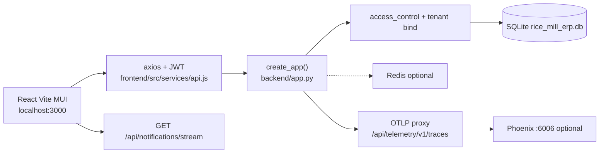

# COMPOSABLE ERP — Phase 1: Codebase Analysis & Gap Assessment

**Repo:** `D:\GenAi\millmitra`  
**Date:** 2026-10-25  
**Scope:** Analysis only of what exists today, measured against a Composable ERP target. No invented features.

---

## 1. Executive summary

MillMitra today is a **working rice-mill operations product**, not a composable ERP platform. The office UI is a React 18 + Vite 4 + MUI 5 SPA. The mill API is Flask 3.0.3 + SQLAlchemy on a **single SQLite file** (`rice_mill_erp.db`) with optional Postgres via `DATABASE_URL`. Live mill work is real: farmers, paddy intake, godown stock, batches, customers, orders, invoices, payments, admin Users/Access, admin lookups, JWT tenancy (Model A), OpenTelemetry proxy, and a chat/voice assistant overlay.

**Honest maturity vs Composable ERP target: early SaaS mill monolith (~20%).**

| Capability | Today | Target |
|---|---|---|
| Plugin / Core Kernel | None. Blueprints registered by hand in `backend/app.py` | Discoverable modules |
| Metadata-driven entities / forms / workflows | Hardcoded SQLAlchemy models + Formik/Yup dialogs | Entity/Field/Form/View definitions |
| Multi-tenant | Shared schema + application `tenant_id` filter | Shared RLS **and** DB-per-tenant |
| i18n | UI dictionaries `en`/`hi`/`te`; lookup `label_*` columns | DB-stored translatable content + RTL |
| UI | MUI pages, no form builder | Headless API + dynamic renderer + Tailwind/shadcn |
| IIoT / offline / reconcile | None. PWA SW is production-only cache | MQTT, TSDB, IndexedDB queue, supervisor resolve |

What is strong: mill domain, RBAC, lookup proto-metadata, tenant isolation tests, Playwright e2e, OTEL, assistant action whitelist. What is missing is the **platform layer**. `docs/SAAS_ARCHITECTURE.md` already states this is not Kubernetes, not an API gateway, and not Postgres RLS.

---

## 2. As-is architecture and tech stack

There is no plugin bus, no message broker, no MQTT client in the running mill path, and no time-series store.

### Tech stack (from lockfiles / pins)

| Layer | Package | Version source |
|---|---|---|
| UI | react, react-dom | `^18.2.0` — `frontend/package.json` |
| Bundler | vite | `^4.1.0` |
| Design | @mui/material | `^5.11.0` (Emotion; **no Tailwind, no Radix, no shadcn**) |
| Data | axios `^1.3.0`, react-query `^3.39.0`, formik, yup | package.json |
| Router | react-router-dom | `^6.8.0` |
| Charts | recharts | `^2.5.0` |
| API | Flask | `3.0.3` — `backend/requirements.txt` |
| ORM | SQLAlchemy | `>=2.0.35,<2.1` (live venv may be newer after Phoenix installs) |
| Auth | Flask-JWT-Extended | `4.6.0` |
| DB drivers | `psycopg[binary]>=3.2.3`, PyMySQL | pinned; **default URI is SQLite** |
| Cache | redis `5.2.0` | optional; app starts without it |
| OTEL | opentelemetry-* `1.32.1` / `0.53b1` | requirements.txt |
| OCR | pytesseract, Pillow | optional Tesseract binary |
| E2E | @playwright/test | `^1.63.0` |
| Python | 3.13 on Windows | README / requirements header |

`Flask-Migrate` is initialized in `backend/extensions.py` but **there is no `alembic/` tree**. Schema evolves via `db.create_all()` plus `services/tenant_migration.py` ALTER scripts.

---

## 3. Database schema overview

### Tenant-scoped (have `tenant_id`)

From `backend/services/tenant_migration.py` `TENANT_TABLES` and matching models:

`farmers`, `farmer_contracts`, `paddy_procurements`, `farmer_edit_requests`, `paddy_stock`, `product_stock`, `stock_movements`, `production_batches`, `quality_tests`, `customers`, `sales_orders`, `invoices`, `payments`, `payment_schedules`, `expenses`, `transactions`, `notifications`, `lookup_options`, `mill_config`, `gst_filing_records`, `saved_reports`, `role_permissions`.

`tenant_id` is `String(36)` **indexed, not an FK** on those mill tables (except `tenant_memberships.tenant_id` → `tenants.id`).

### Global / not tenant-scoped

| Table / model | File | Notes |
|---|---|---|
| `users` | `backend/models/user.py` | Global identity; `username`/`email` unique worldwide |
| `tenants`, `tenant_memberships` | `backend/models/tenant.py` | Tenancy catalog |
| `auth_logs`, `user_sessions`, `user_preferences` | `user.py` | No `tenant_id` |
| `ai_interactions` | `backend/models/__init__.py` | No `tenant_id` |
| `budgets` | `backend/models/finance.py` | No `tenant_id` |
| `financial_alerts`, `cash_flow_forecasts`, `financial_health_scores` | `financial.py` | No `tenant_id` |
| `equipment`, `maintenance_*`, `equipment_readings`, `spare_parts` | `maintenance.py` | No `tenant_id` |
| `vehicles`, `drivers`, `routes`, `shipments*` | `logistics.py` | No `tenant_id` |
| `suppliers`, `purchase_orders*` | `supply_chain.py` | No `tenant_id` |
| `quality_standards`, inspections, alerts | `quality.py` | Separate from live `quality_tests` |
| `compliance_*`, `audit_trails` | `compliance.py` | No `tenant_id` |
| `dashboards`, `dashboard_widgets`, `kpis*` | `analytics.py` | **Not used by live Dashboard.jsx** |

### Real FKs on the live mill path

- `paddy_procurements.farmer_id` → `farmers.id`
- `farmer_contracts.farmer_id` → `farmers.id`
- `farmer_edit_requests` → farmer
- `sales_orders` / `invoices` → customer (sales/finance models)
- `created_by` columns → `users.id`
- `tenant_memberships.user_id` → `users.id`, `.tenant_id` → `tenants.id`

### SQLite vs Postgres readiness

- Default: `sqlite:///rice_mill_erp.db` (`backend/config.py`).
- Postgres is **declared** (`psycopg[binary]`) but not the local default; no RLS policies exist.
- **Global UNIQUE** on business codes (`farmer_code`, `batch_number`, `invoice_number`, `customer_code`, …) will collide across mills. Isolation tests pass because they use different codes, not because uniqueness is per-tenant.
- `tenant_migration.py` uses generic `ALTER TABLE ... ADD COLUMN` — works on SQLite and Postgres, but is not a versioned migration.

---

## 4. Multi-tenancy vs requirement

**Implemented (Model A):** shared DB, shared schema, `tenant_id` on the mill tables listed above. JWT `tenant_id` claim; `X-Tenant-ID` only if membership exists; suspended mill → 403 except `/api/tenants` and `/api/auth/me`. Query helper `tq()` / `t_get()` in `backend/services/tenant_scope.py`. Flush guard stamps `tenant_id`. Tests: `backend/tests/test_tenancy.py`.

**Not implemented:**

- Postgres **RLS**. Isolation is application-layer. A missed `tq()` leaks rows. Documented as such in `docs/SAAS_ARCHITECTURE.md`.
- **Database-per-tenant.** No `tenant.db_url`, no engine router, one SQLAlchemy bind.
- Whole-file SQLite **backup copies all tenants**.
- Models outside `TENANT_TABLES` are global if created.

**Verdict:** shared-schema tenancy is real and tested. RLS + DB-per-tenant are absent.

---

## 5. i18n vs requirement

**Have:**

- `frontend/src/i18n/I18nContext.jsx` + `translations.js` locales `en`, `hi`, `te` (`LOCALES`).
- `localStorage` key `millmitra.language`.
- Navbar language switch; Playwright `frontend/e2e/language.spec.js`.
- Lookups store `label_en` / `label_hi` / `label_te` (`backend/models/lookup.py`). UI uses `optionLabel(option, locale)` in `frontend/src/services/lookupService.js`.
- Role/status display keys (`roleLabel`, `statusLabel`) without changing stored role keys.

**Do not have:**

- RTL. Grep of `frontend/src` finds **no** `dir=`, `rtl`, or `direction`.
- A translation table for farmer names, invoice notes, dashboard titles, notification bodies.
- Lookup **seed** often copies English into `label_hi` / `label_te` (`lookup_service._row`).
- ICU / plural / locale-aware numbers beyond `en-IN` formatters in a few pages.
- Server-driven locale catalogs.

**Verdict:** UI chrome is multilingual. Content in the database is not a translation system. RTL is zero.

---

## 6. RBAC and admin configurability vs metadata-driven

**Have:**

- Fixed permission keys in `backend/services/access_control.py`: `dashboard`, `mill_flow`, `farmers`, `inventory`, `production`, `quality`, `sales`, `customers`, `finance`, `settings`, `users`, `lookups`, `preview`.
- Fixed roles: admin, manager, operator, quality_control, sales, accountant.
- `role_permissions` rows per tenant; `/access` UI toggles them.
- Path → permission map on the server (`permission_for_path`) and client (`frontend/src/utils/permissions.js`).
- Lookups: 30+ `GROUP_KEYS` in `lookup_service.py`; admin `/lookups`; `stock_type` and `batch_status` locked.

**Do not have:**

- Entity / field / form / view metadata tables.
- Custom fields on farmer/customer/product.
- Workflow definitions (no state machine engine). `AuditTrail` exists in `compliance.py` and is not the live mill audit path.
- Permission keys for metadata, IIoT, or reconciliation.
- Dynamic menus from the server (sidebar is a hardcoded array in `frontend/src/components/Sidebar.jsx`).

**Verdict:** RBAC + lookups are a **proto-metadata** layer for enums and module gates. They are not a metadata engine.

---

## 7. UI vs headless / dynamic UI

**Have:**

- MUI 5 theme in `frontend/src/App.jsx` (green `#2E7D32`).
- Hardcoded routes and pages under `frontend/src/pages/*.jsx` (Dashboard, MillFlow, Farmers, Inventory, Production, Sales, Finance, Customers, Settings, Users, Access, Lookups, plus preview Analytics / Quality / FI / GST).
- Shared chrome: `PageShell` / `PageHeader` in `frontend/src/components/common/PageChrome.jsx`.
- Forms: Formik + Yup or local `useState` in dialogs (`RegisterFarmerDialog.jsx`, `RecordProcurementDialog.jsx`, `AddStockDialog` in `Inventory.jsx`, sales/finance dialogs).
- Live dashboard widgets call mill APIs (not the unused `dashboards` / `dashboard_widgets` tables).
- Assistant overlay (`frontend/src/assistant/`) fills **registered** dialogs; it does not generate UI.

**Do not have:**

- Headless form/view JSON consumed by a renderer.
- Form builder or dashboard builder that persists layouts as metadata.
- Tailwind, Radix, shadcn.
- TypeScript.
- OpenAPI / Flask-RESTful resources (Flask-RESTful is pinned but unused).

**Verdict:** A conventional MUI SPA over REST. Salvage pages; do not pretend they are a builder.

---

## 8. IIoT / ingestion / offline vs requirement

**Have:**

- Production-only service worker `frontend/public/sw.js` (`millmitra-v3.0.0`) — static/SPA cache + `offline.html`. **Not registered in `npm run dev`** (`frontend/src/utils/pwaRuntime.js` unregisters leftovers).
- Notifications: DB rows + SSE `GET /api/notifications/stream` (`backend/routes/notifications.py`, `frontend/src/services/notificationService.js`).
- `EquipmentReading` (`backend/models/maintenance.py`) is a **relational** row (equipment_id, reading_type, value) with **no tenant_id**, and it is not on the live mill IIoT path.
- Redis optional; Celery URLs in `config.py` are unused by mill routes.
- Assistant and ID extract are request/response, not telemetry.

**Do not have:** Kafka, RabbitMQ, NATS, MQTT subscriber, TimescaleDB/Influx, IndexedDB write queue, conflict/reconciliation, device tokens, Background Sync of mill mutations.

**Verdict:** Near-zero IIoT. PWA is install/cache, not offline-first ERP.

---

## 9. Gap matrix

| Requirement | Action | Reasoning | Risk |
|---|---|---|---|
| Core Kernel + plugins | **Build new** | `app.py` lists blueprints. No discover/`register(app, kernel)`. | Breaking import order / double-register if sloppy |
| Metadata entities / fields / forms / views | **Build new** | No tables. Lookups are enum-only. | Scope creep if every Formik dialog is rewritten at once |
| Custom fields on farmer/customer/product | **Build new** + salvage records | Need `CustomFieldValue` keyed by tenant + record_id | Isolation bugs if not using `tq()` |
| Workflows | **Build new** (later) | No engine. Do not fake one in Phase 3. | Over-design vs mill day |
| Shared-DB `tenant_id` | **Salvage** | Works; tested | Missed `tq()` on new tables |
| Postgres RLS | **Build new** (scripts only on SQLite) | SQLite cannot apply RLS | False sense of security if scripts unused |
| DB-per-tenant | **Build new** (router + optional `db_url`) | Nothing exists | Untested Postgres binds; test with second SQLite |
| UI i18n en/hi/te | **Salvage** | Context + dictionaries | Incomplete te/hi strings |
| DB translatable content | **Build new** | Only lookup labels | Seed still English-cloned |
| RTL | **Build new** | Zero today | MUI theme direction + layout bugs |
| Headless API | **Refactor** | REST exists; not schema-described | Dual UI/API drift |
| Dynamic form/view builder | **Build new** | No renderer | Must not restyle all MUI pages |
| Custom dashboards | **Build new** using live APIs | `analytics.Dashboard` unused | Confuse sample vs live widgets |
| Tailwind + shadcn | **Staged / do not force** | MUI+Tailwind preflight fights | Visual regression if forced now |
| Event bus | **Build new** | No broker | Keep mill start without Redis |
| MQTT + edge | **Build new** | No client | App must start if broker unset |
| Time-series | **Build new** table + Timescale script | `equipment_readings` is not a TSDB | SQLite will not be a hypertable |
| Manual ingest + reconcile | **Build new** | None | Supervisor UX + audit |
| Offline-first IndexedDB | **Build new** | SW cache only; SW off in dev | Must work without SW |
| Assistant whitelist | **Salvage** | `assistant_service.py` | Do not turn it into an agent framework |
| OTEL | **Salvage** | `telemetry.py`, `frontend/src/telemetry.js` | SAAS doc is stale (says OTEL not built) |
| Playwright e2e | **Salvage** | `frontend/e2e/*.spec.js` | Fragile selectors if chrome changes |

---

## 10. What to salvage explicitly

1. **Tenant model** — `Tenant`, `TenantMembership`, JWT claim, `tq()` / flush stamp, `test_tenancy.py`.
2. **RBAC** — `PERMISSIONS`, `RolePermission`, `/access`, `RequireAccess`.
3. **Lookups as proto-metadata** — `LookupOption` + `GROUP_KEYS` + `useLookup`.
4. **i18n context** — `I18nProvider`, `t()`, locale persistence.
5. **OTEL** — Flask + browser proxy to `/api/telemetry/v1/traces`.
6. **Assistant action whitelist** — navigate/open/fill allow-lists and permission filter (`backend/services/assistant_service.py`).
7. **E2E** — Playwright mill-day specs + `docs/BUSINESS_SCENARIOS.md`.
8. **Live mill dialogs** — Register Farmer, Add Stock, Record Procurement, Mill flow — keep MUI, attach metadata as a **section**.
9. **Notifications SSE** — pattern for later IIoT live updates (not a substitute for a broker).

---

## 11. Risks and open decisions (resolved for later phases unless overturned)

These were open at analysis time. Implementation mandate after this file: keep Flask + React/Vite; keep MUI; SQLite local + Postgres-ready models; in-process bus + Redis Streams adapter; MQTT optional via `MQTT_BROKER_URL`; `machine_telemetry` table + Timescale SQL script.

| Decision | Risk if wrong |
|---|---|
| Flask vs Node/Next rewrite | Rewrite throws away tenancy/RBAC/e2e. **Keep Flask.** |
| MUI vs Tailwind/shadcn now | Dual CSS reset. **Keep MUI; Tailwind is a staged later migration.** |
| SQLite vs Postgres now | RLS and hypertables need Postgres. **SQLite stays local default.** |
| Broker (Kafka vs NATS vs Redis) | Kafka ops-heavy on Windows. **In-memory + Redis Streams; Kafka stub.** |
| TSDB (Timescale vs Influx) | Extra process. **SQL table now; Timescale script unused on SQLite.** |
| Python IIoT ingestion | Thread + paho in Flask process is fine for mill-scale; not a factory SCADA bus. |

Other risks: global UNIQUE codes; silent `startup_schema_failed`; Phoenix/SQLAlchemy pin drift; leftover `toberemoved/` and unused models looking like features.

---

## 12. Recommended Phase 2 inputs

Answered by the implementation mandate (see Phase 2). Remaining product questions:

1. Which entities get custom fields first beyond farmer / customer / product?
2. Who is a “supervisor” for discrepancies — manager, admin, or a new role?
3. Device token lifecycle (rotate, revoke) for edge gateways?
4. How long to retain telemetry on SQLite before Postgres/Timescale?
5. Should plugin menu items replace or append to the hardcoded sidebar?
6. Is `ur` acceptable as the sample RTL locale (no native mill copy yet)?

---

## Evidence index (files re-read)

`backend/app.py`, `backend/config.py`, `backend/extensions.py`, `backend/requirements.txt`, `backend/models/*`, `backend/services/access_control.py`, `tenant_*.py`, `lookup_service.py`, `assistant_service.py`, `observability.py`, `telemetry.py`, `backend/routes/notifications.py`, `backend/tests/test_tenancy.py`, `frontend/package.json`, `frontend/src/App.jsx`, `i18n/*`, `services/api.js`, `PageChrome.jsx`, `Sidebar.jsx`, `assistant/`, `public/sw.js`, `pwaRuntime.js`, `frontend/e2e/*`, `docs/SAAS_ARCHITECTURE.md`, `docs/TECHNICAL.md`, `README.md`.
