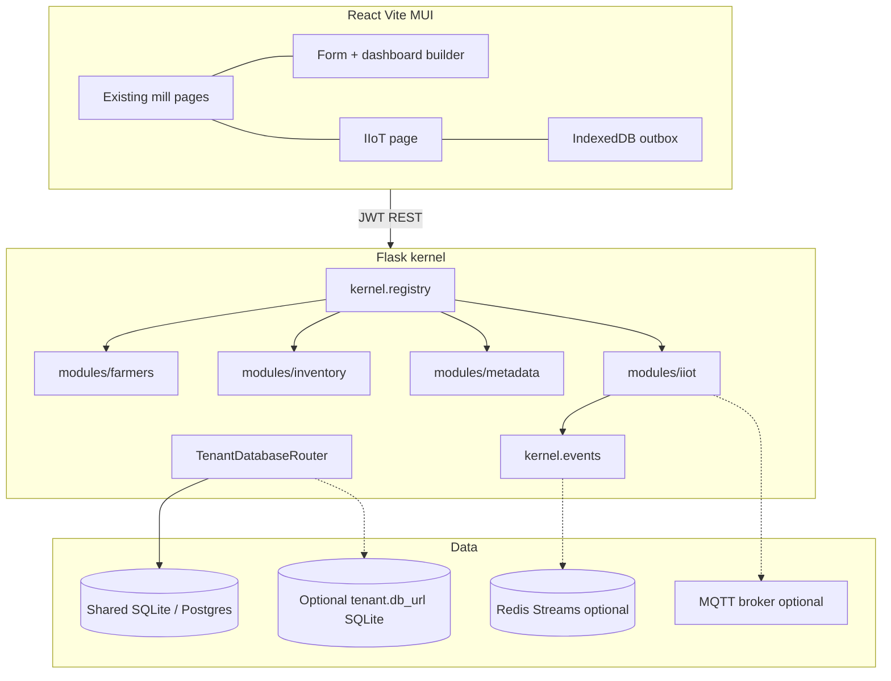
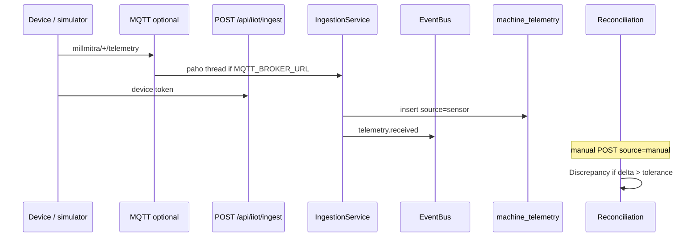

# COMPOSABLE ERP — Phase 2: Architecture (decisions locked)

**Repo:** `D:\GenAi\millmitra`  
**Depends on:** [COMPOSABLE_ERP_PHASE1.md](COMPOSABLE_ERP_PHASE1.md)

This is the architecture we implement in Phases 3–5. It is **not** a rewrite.

---

## 1. Tech stack (decisions)

| Concern | Decision | Reason |
|---|---|---|
| API | **Keep Flask 3 + SQLAlchemy** | Salvage tenancy, RBAC, lookups, OTEL, assistant, tests |
| UI | **Keep React 18 + Vite 4 + MUI 5** | Salvage pages and e2e. No Next.js |
| Tailwind / shadcn / Radix | **Staged later. Not added now** | Preflight vs MUI CssBaseline; restyling every page is out of scope |
| Local DB | **SQLite** `rice_mill_erp.db` | Current mill default |
| Production DB | **Postgres-ready models**; RLS SQL in `backend/scripts/postgres_rls.sql` (not applied on SQLite) | UUID strings, no new SQLite-only SQL |
| DB-per-tenant | `Tenant.db_url` + `TenantDatabaseRouter` | Default bind = shared DB. Optional second SQLite file per tenant for tests |
| Event bus | In-process + **Redis Streams** adapter if `REDIS_URL` set; **Kafka stub** | `redis` already in requirements; Kafka not required to start |
| MQTT | **paho-mqtt** only if `MQTT_BROKER_URL` set | App starts without Mosquitto |
| Time-series | Table `machine_telemetry`; Timescale `create_hypertable` in `backend/scripts/timescaledb_telemetry.sql` | Same rows on SQLite |
| Offline | IndexedDB queue + online/`sync` button; SW Background Sync **only in production** | Dev unregisters SW |
| I18n | Keep en/hi/te; add **`ur` sample RTL** + `document.dir` + MUI `direction` | RTL proof without a full Urdu translation |
| Language | Python stays for IIoT ingest in-process | Mill-scale; no separate Node ingest |

---

## 2. System architecture



Request path stays: JWT → `bind_tenant` → `g.tenant_id` → `tq()` / router bind → SQLAlchemy.

---

## 3. Tenant database strategy

### Shared schema (default)

- Keep `tenant_id` + `tq()`.
- Postgres RLS policies live in `backend/scripts/postgres_rls.sql` as `CREATE POLICY ... USING (tenant_id = current_setting('app.tenant_id'))`. **Not executed on SQLite.**
- Before each Postgres request (future): `SET LOCAL app.tenant_id = ...`.

### Per-tenant database (optional)

- Column `tenants.db_url` (nullable). Empty = shared bind.
- `TenantDatabaseRouter.engine_for(tenant)` caches engines.
- On first use of a non-empty `db_url`, `create_all` on that bind.
- **Tested** with a second SQLite file. Live Postgres-per-tenant is wired but **not claimed production-ready**.

Users remain global on the shared database. Membership always lives on the shared catalog.

---

## 4. Plugin / module folder structure

```
backend/kernel/
  registry.py          # discover backend/modules/*/plugin.py
  events.py            # EventBus + InMemory + RedisStreams + KafkaAdapter
  tenant_router.py     # TenantDatabaseRouter
  translations.py      # TranslatedText helper
backend/modules/
  farmers/plugin.py    # register existing farmer_bp
  inventory/plugin.py  # register existing inventory_bp
  metadata/plugin.py   # metadata admin APIs
  iiot/plugin.py       # devices, ingest, reconcile
```

`plugin.py` must expose:

```python
def register(app, kernel):
    kernel.add_blueprint(...)
    kernel.add_permissions(...)
    kernel.add_lookup_groups(...)
    kernel.add_menu_items(...)
```

Existing URLs (`/api/farmer`, `/api/inventory`) do not change.

---

## 5. Metadata model design

All tenant-scoped:

| Model | Purpose |
|---|---|
| `EntityDefinition` | key (`farmer`, `customer`, `product`), label |
| `FieldDefinition` | entity, name, type, required, lookup_group, translatable, sort |
| `FormLayout` | entity, json `{ sections, field_keys[] }` |
| `ViewDefinition` | entity, json columns |
| `CustomFieldValue` | entity, record_id, field, value JSON |
| `TranslatedText` | entity, record_id, field, lang, text |
| `DashboardLayout` | user_id + tenant, json widgets |

Admin CRUD requires permission `metadata`. Custom fields attach to existing integer PKs.

---

## 6. Ingestion / offline / reconciliation



Offline: browser queues `{device_id, metric, value, reason}` in IndexedDB; flush on `online` or Sync button; production SW can ping the same flush.

---

## 7. UI approach

- New pages (IIoT, Form builder, Dashboard builder) use **existing MUI + PageChrome**.
- `CustomFieldsSection` mounts inside Register Farmer and Create Customer.
- MUI `theme.direction` follows `locale === 'ur' ? 'rtl' : 'ltr'`.
- Tailwind is **not** introduced in this phase.

---

## 8. Phase 3–5 delivery order

1. Kernel + router + metadata tables + translations + RTL + permissions.  
2. IIoT module + bus + ingest + discrepancies + page + offline queue + simulator.  
3. Form builder + dashboard layout persistence.  
4. Tests, lint, build, e2e, docs.
